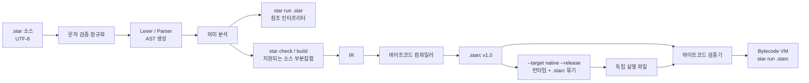

# star.lang

세상에 "별 언어"가 다 있다.

Star는 `*`, `'`, `"` 세 가지 기호를 중심으로 명령을 표현하는 범용 스택 기반 언어입니다. 소스는 간결한 기호열이고, 명령의 의미와 실행 규칙은 v1.0 사양으로 정의합니다.

## 사용하는 문자

| 문자 | 역할 |
|---|---|
| `*` | 명령·데이터 비트에서 `1` |
| `'` | 명령 구분자이며 데이터 비트에서는 `0` |
| `"` | 데이터 리터럴의 시작과 끝 |

기본 명령은 `*`를 N개 쓴 뒤 `'`로 닫습니다. 확장 명령은 `'`와 8개의 비트 기호, 마지막 `"`로 씁니다. 데이터 리터럴은 `"` 사이의 비트열이며, 가장 왼쪽 비트가 최상위 비트입니다. 일반 모드에서는 ASCII 공백·탭·CR·LF를 무시해 줄바꿈과 들여쓰기로 소스를 읽기 좋게 쓸 수 있습니다. UTF-8 BOM, 다른 문자, 비슷하게 생긴 유니코드 기호는 허용하지 않습니다.

## 문법

프로그램은 명령, 데이터 리터럴, 중첩된 블록을 이어 쓴 형태입니다. 세미콜론은 필요하지 않습니다. 기본 명령은 별표 수와 아포스트로피로 끝을 구분하고, 확장 명령은 고정 길이 비트열과 따옴표로 구분합니다.

대표적인 구조는 조건문 `IF … [ELSE …] END`, 반복문 `LOOP … END`, `FOR … END`, 함수 `FUNC … END`와 `ASYNC_FUNC … END`, 스코프 `SCOPE_BEGIN … SCOPE_END`, 예외 처리 `TRY … [CATCH …] [FINALLY …] END`입니다. `TRY`에는 `CATCH` 또는 `FINALLY`가 하나 이상 필요하며, 둘 다 있으면 `CATCH`가 먼저 옵니다. 여기 표시한 이름은 읽기 편하게 쓴 명령 이름이며 실제 소스에서는 해당 명령의 기호 인코딩을 사용합니다. 각 블록의 세부 규칙은 [문법 사양](spec/grammar.ebnf)과 [제어 흐름 사양](spec/control-flow.md)을 참고하세요.

## 간단한 예제

아래 프로그램은 1과 2를 스택에 넣고 더한 뒤 출력합니다.

```star
"*"    "*'"    *'    ******'
```

`"*"`는 비트값 1인 정수 1, `"*'"`는 비트열 `10`인 정수 2입니다. `*'`는 `ADD`, `******'`는 `PRINT`입니다. 실행 결과는 `3`입니다.

```sh
# calc.star로 저장한 뒤 실행
cargo run -p star-cli -- run calc.star

# 정적 검사와 .starc 생성
cargo run -p star-cli -- check calc.star
cargo run -p star-cli -- build calc.star --output calc.starc
cargo run -p star-cli -- run calc.starc
```

## 파일 형식

- **`.star`**: UTF-8로 저장한 소스 파일입니다. 일반 모드에서는 `*`, `'`, `"`와 허용된 ASCII 공백 문자만 사용합니다.
- **`.starc`**: 상수·모듈·함수·명령 코드를 담는 버전형 바이트코드 컨테이너입니다. 실행 전에 검증하며, 파일 형식 버전은 v1.0입니다.
- **독립 실행 앱**: `star build --target native --release`가 현재 플랫폼의 Star 실행 파일에 검증된 `.starc`와 권한 정보를 묶습니다. 네이티브 기계어로 변환하는 AOT 컴파일은 아닙니다.

## 작동 방식



`star run file.star`는 소스를 참조 인터프리터로 실행합니다. `.starc`와 독립 실행 앱은 검증을 거친 뒤 Bytecode VM에서 실행됩니다. 일부 유효한 소스 구조는 v1.0에서 바이트코드로 낮추지 못할 수 있으며, CLI의 지원 범위와 진단은 [CLI 사양](spec/cli.md)에 설명되어 있습니다.

## 사양과 릴리스

- [Star v1.0 전체 사양 목차](spec/index.md)
- [호환성 정책](spec/compatibility.md)
- [Star v1.0.0 릴리스](https://github.com/soyuo/star.lang/releases/tag/v1.0.0)

이 저장소의 Rust 워크스페이스를 검사하려면 다음을 실행하세요.

```sh
cargo check --workspace
```
